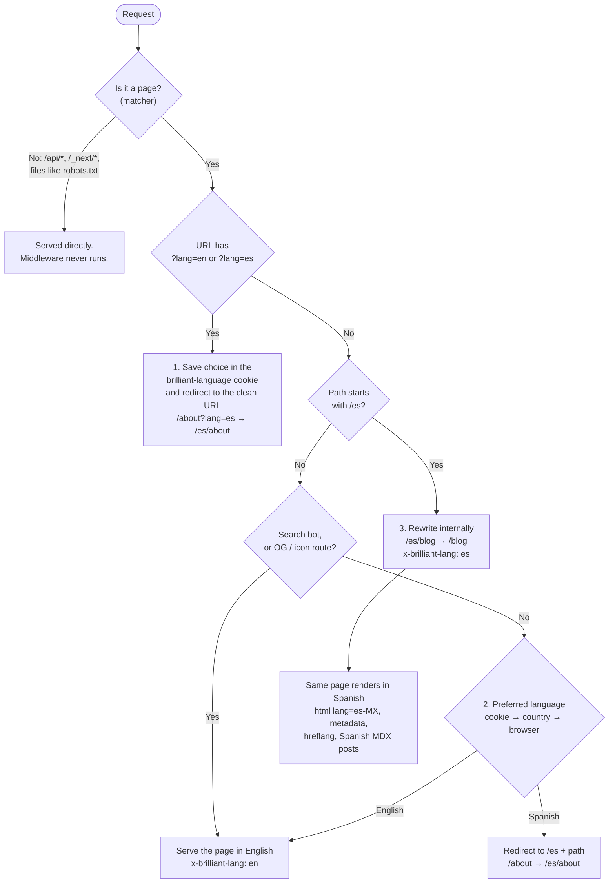

# Why there is a middleware

The site has one set of pages (`app/`) and two languages. There is no `app/es/`
folder. `middleware.ts` runs before every page request and decides which
language to serve. Without it, `/es` would 404 and nobody would get Spanish
automatically.

## The flow

## The three jobs

| # | Job | Example |
|---|-----|---------|
| 1 | **Language switch.** The footer links add `?lang=`; the choice is saved for a year. | `/about?lang=es` → cookie `es` → `/es/about` |
| 2 | **Auto-Spanish.** First match wins: saved cookie, then country (Mexico and the Latin American list in `lib/locale.ts`, from Vercel's country header), then the browser's `Accept-Language`. Bots are skipped so search engines index both languages as-is. | Visitor from Mexico opens `/` → `/es` |
| 3 | **Serve `/es` from the same pages.** The URL keeps `/es`; the server renders the unprefixed route and reads `x-brilliant-lang` / `x-brilliant-path` to pick the language. | `/es/blog/x` renders `app/blog/[slug]` in Spanish |

## What it skips, and why

The matcher in `middleware.ts` skips `/api/*`, `/_vercel/*` (Vercel Web
Analytics posts page views there), `/_next/static`, `/_next/image`, and any
path with a dot (files). API routes have no language. Before this was
excluded, a Spanish-preference visitor's form POST to `/api/inquiry` was
redirected to `/es/api/inquiry` and rewritten back: it worked, but every
submission took an extra round trip. `tests/locale.test.cjs` keeps API routes
out of the matcher.
